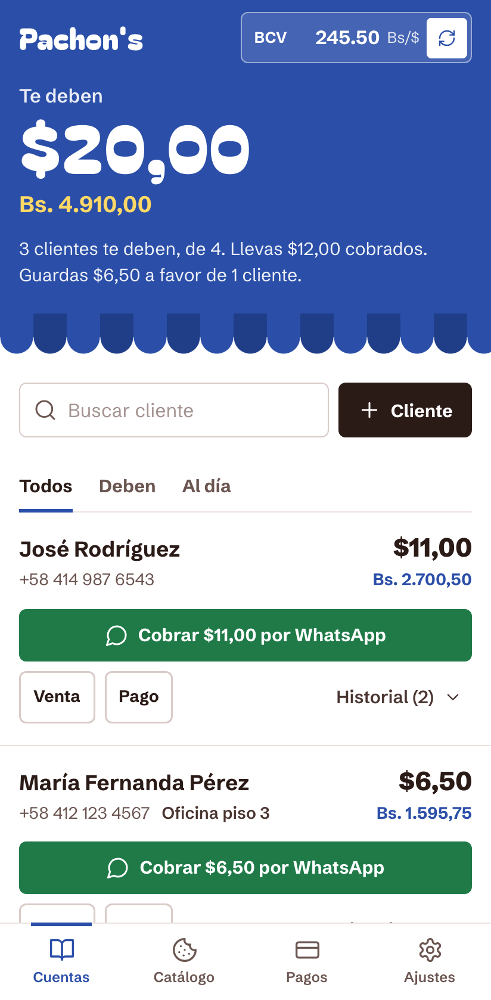
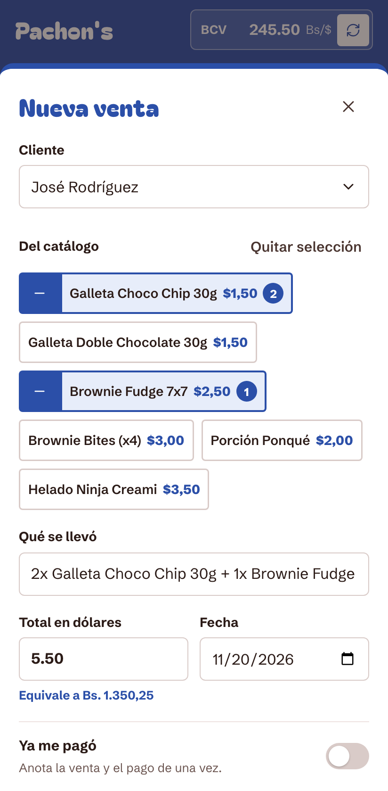
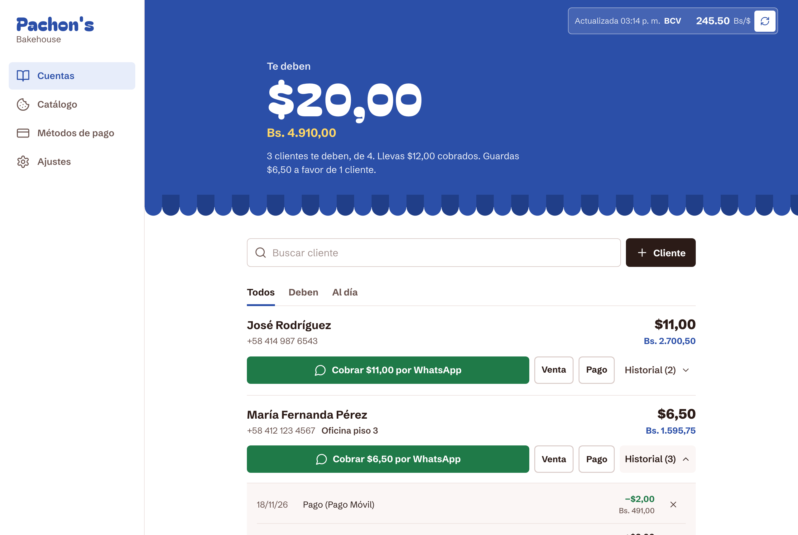

# BakeHouse

[](https://github.com/carlos-arciniegas/BakeHouse/actions/workflows/ci.yml)

App web para que negocios pequeños de repostería lleven la libreta de fiados: quién debe cuánto, ventas, pagos y cobros por WhatsApp. Se instala en el teléfono y funciona sin conexión.

**Demo:** [carlos-arciniegas.github.io/BakeHouse](https://carlos-arciniegas.github.io/BakeHouse/). En la pantalla vacía, "Ver un ejemplo" carga un cliente de prueba. Los datos quedan solo en tu navegador.

<p align="center">
  
  &nbsp;
  
</p>



## El problema

La app nació para Pachon's Bakehouse, una repostería casera en Caracas que vende galletas y brownies a vecinos y oficinas, muchas veces fiado. El control se llevaba en un cuaderno y los cobros se escribían a mano por WhatsApp, calculando cada vez el monto en bolívares con la tasa del día.

BakeHouse resuelve eso en el teléfono:

- **Cuánto te deben**, en dólares y en bolívares (tasa oficial del BCV, que se actualiza sola).
- **Anotar una venta en pocos toques**: los productos del catálogo suman cantidades ("2x Galleta + 1x Brownie") y el total sale solo. Si el cliente paga en el momento, venta y pago se anotan de una vez.
- **Cobrar por WhatsApp con un toque**: el mensaje lleva el saldo, las últimas compras y los datos para pagar (Pago Móvil, transferencia, Bizum, Zelle…).
- **Saldo a favor**: si alguien paga de más, se guarda y se descuenta de su próxima compra.
- **Pensada para venderse a otros negocios**: nombre, país, moneda y métodos de pago se configuran. Funciona en Venezuela, España, Portugal, Italia, Francia, Alemania, Reino Unido y Estados Unidos.

## Stack

React 19 · TypeScript · Vite · Vitest · Playwright · vite-plugin-pwa · GitHub Actions · GitHub Pages

Sin librerías de componentes ni de estado: el diseño es CSS propio y el estado vive en `useReducer` y contexto.

## Decisiones técnicas

**Sin backend, datos en el navegador.** El primer cliente usa la app desde un solo teléfono y a veces sin conexión. `localStorage` y una PWA cubren ese caso sin costo de servidor. A cambio, el respaldo depende del usuario, así que hay copias de seguridad en JSON e importación desde Excel (CSV). Un backend con cuentas, por ejemplo Supabase, sería el paso siguiente para vender la app con suscripción.

**Lógica pura separada de React.** Todo lo que tiene reglas de negocio vive en `src/logica/` como funciones puras que no tocan el DOM ni `localStorage`: saldo, monedas, teléfonos, mensajes de WhatsApp y tasa BCV. Los componentes solo muestran datos y llaman a esas funciones. Eso permite probar la lógica en milisegundos y cambiar la interfaz sin miedo.

**Un reductor para todos los cambios.** Cada operación (anotar venta, registrar pago, deshacer…) es una acción de un reductor puro. "Deshacer" se resuelve reinsertando el movimiento en su posición original, y el guardado solo escribe en `localStorage` la parte del estado que cambió.

**Compatibilidad con los datos existentes.** La app empezó como un único `index.html` y el cliente ya tenía datos guardados. La versión en React conserva las mismas claves de `localStorage`, migra el formato viejo de Pago Móvil a la lista de métodos de pago y valida todo lo que lee, porque un dato corrupto no debe romper la app.

**Saldo = ventas − pagos, con signo.** Un saldo positivo es deuda y uno negativo es saldo a favor. La primera versión ocultaba los negativos con `Math.max(0, …)` y el dinero adelantado "desaparecía". Ahora se muestra en la fila, en el resumen y en el estado de cuenta.

**Varios países sin código especial por país.** Cada país es una entrada de configuración: moneda, formato y prefijo telefónico. Los montos se formatean con `Intl.NumberFormat` ("17,50 €", "$11,00", "£11.00"). Los teléfonos se normalizan al formato internacional que pide WhatsApp, sea cual sea la forma en que se escriban: con 0, con +, con 00 o con el prefijo ya puesto. Los bolívares y la tasa BCV solo aparecen si el país es Venezuela.

**Menos toques, más claridad.** Cada flujo se diseñó contando toques:

| Tarea | Antes | Ahora |
|---|---|---|
| Venta que se paga en el momento | ~7 toques (venta y luego pago) | 3 toques ("Ya me pagó") |
| Registrar que pagó todo | 3 toques | 2 (el monto viene con la deuda) |
| Borrar algo por error | Confirmar y no había vuelta atrás | 1 toque, con "Deshacer" |

**PWA que no interrumpe.** Funciona sin conexión gracias al *service worker*. Cuando hay una versión nueva, la app avisa y deja que el usuario elija cuándo actualizar, en lugar de recargarse en medio de una venta.

**Animaciones con propósito.** Solo se anima lo que cambió (el total que cuenta hasta el valor nuevo, la fila que se resalta, las hojas que suben). Todo respeta `prefers-reduced-motion`.

## Pruebas

| Tipo | Herramienta | Qué cubre |
|---|---|---|
| Unitarias (82) | Vitest | Saldos, monedas, teléfonos de 8 países, mensajes de WhatsApp, migraciones, respaldos, CSV, reductor |
| Punta a punta (34) | Playwright | 17 flujos reales, cada uno en móvil (Pixel 7) y escritorio, incluido el uso sin conexión |

Las pruebas de punta a punta corren contra la app compilada, con datos en el formato viejo y la tasa BCV simulada, para que no dependan de la red.

En cada push, GitHub Actions corre lint, tipos y ambas suites. Si todo pasa en `main`, la app se publica sola en GitHub Pages.

## Cómo correrla

Requiere Node 24.

```bash
npm ci
npm run dev          # servidor de desarrollo
npm test             # pruebas unitarias
npx playwright install chromium   # solo la primera vez
npm run test:e2e     # pruebas de punta a punta
npm run lint         # oxlint
npm run typecheck    # TypeScript
npm run build        # compila en dist/
```

## Estructura

```
src/
├─ logica/       funciones puras del dominio, con sus pruebas
├─ datos/        localStorage, migraciones, respaldo JSON y CSV
├─ estado/       reductor, contextos y proveedores de React
├─ componentes/  marco, vistas, hojas (modales) y piezas base
└─ estilos/      CSS propio
e2e/             pruebas de Playwright
```

## Cómo se hizo

Desarrollé el proyecto con Claude Code como asistente de programación: diseño, migración de JavaScript a React y TypeScript, y pruebas. Los commits que hizo con mi aprobación lo indican con `Co-Authored-By`.

---

© 2026 Carlos Arciniegas. Todos los derechos reservados.
